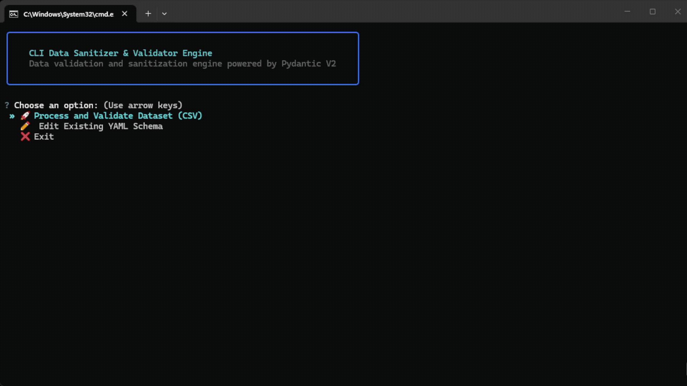

# CLI Data Sanitizer & Validator Engine

[](https://www.python.org/downloads/)
[](https://docs.pydantic.dev/latest/)
[](https://github.com/astral-sh/ruff)
[]

An interactive Command Line Interface (CLI) application designed to validate and sanitize dataset streams (CSV) against dynamically generated **Pydantic V2** schemas defined in YAML or JSON.

---

<p align="center">
  
</p>

---

## 💡 Motivation & Overview

In data engineering pipelines, validating incoming datasets before loading them into databases is crucial to prevent corrupted states. However, hardcoding validation models for every changing dataset structure is rigid and inefficient. 

This project was built to solve this challenge by combining **metaprogramming** with a modern **CLI experience**. It allows users to:
1. Define rules flexibly using configuration files (`YAML`/`JSON`).
2. Generate strict data models dynamically at runtime using **Pydantic V2**.
3. Process data efficiently without memory overhead and audit failures instantly via terminal reports.

---

## ⚙️ How It Works (Execution Flow)

```text
[ YAML / JSON Schema ] ──> Dynamic Model Factory (Pydantic V2)
                                     │
[ CSV Dataset File ]   ──> Generator Streaming Reader ──> Validation Engine ──┬──> Valid JSON Output
                                                                              └──> Error Audit Log
```

---

## 🎯 Key Features

- **Dynamic Schema Metaprogramming:** Builds type-safe Pydantic models at runtime from human-readable YAML/JSON definitions.
- **Memory-Efficient Streaming:** Processes datasets row-by-row using Python generators, keeping memory footprint low even for large files.
- **Interactive Terminal REPL:** Built with `Questionary` and `Rich` for guided data validation and live schema editing.
- **Robust Field Validation & Sanitization:**
  - Type checking (`str`, `int`, `float`, `bool`, `date`, `datetime`, `email`).
  - Boundary limits (`min`, `max`, `min_length`, `max_length`).
  - Safe null handling and optional field defaults.
- **Encoding & Edge Case Handling:** Automatic UTF-8 with BOM stripping (`utf-8-sig`) for seamless compatibility with Microsoft Excel exports.
- **Detailed Audit & Reporting:** Generates structured JSON output files for valid records (`valid_data.json`) and error logs (`errors.json`).

---

## 🛠️ Tech Stack

- **Language:** Python 3.11+
- **Data Validation:** Pydantic V2 (`create_model`, `Field`, `SchemaValidator`)
- **CLI & UI:** `Rich` (tables, status indicators) & `Questionary` (interactive prompts)
- **Configuration & I/O:** `PyYAML`, `json`, `csv`
- **Package Manager & Tooling:** `uv`, `pytest`, `Docker`

---

## 🏗️ Architecture & Project Structure

The project follows solid Object-Oriented and Clean Code practices, enforcing single responsibility for each layer:

```text
src/cli_data_validator/
├── core/               # Domain & Validation Logic
│   ├── engine.py       # Dataset processing engine & metric calculations
│   ├── factory.py      # Dynamic Pydantic model creation
│   └── loader.py       # Configuration schema parsing (YAML/JSON)
├── io/                 # Input/Output Stream Handlers
│   ├── readers.py      # CSV generator-based file streaming
│   └── writers.py      # JSON result and error report export
└── ui/                 # Presentation & REPL Layer
    ├── menu.py         # Main interactive terminal loop
    └── reporter.py     # Rich table rendering for summaries & error logs
```

---

## 🚀 Quick Start & Usage

### Running Locally

```bash
# Clone the repository and sync dependencies with uv
uv sync

# Run the interactive CLI application
uv run python -m cli_data_validator.main
```

### Running with Docker (Recommended for Evaluation)

```bash
# Run interactively via Docker Compose
docker compose run --rm cli-validator
```

---

## 🧪 Running Tests

Run the test suite to verify schema parsing, model generation, and validation correctness:

```bash
uv run pytest -v
```

---

## 📄 License

This project is licensed under the MIT License.

---

## 🔮 Future Enhancements & Roadmap

While the current version fully solves local streaming and dynamic schema validation, the following features are planned for future scale:

- [ ] **Data Source Expansion:** Add built-in support for streaming directly from SQL databases (via SQLAlchemy) and Cloud Storage (AWS S3, Google Cloud Storage).
- [ ] **Parquet & JSON Lines Support:** Extend file reader capabilities beyond CSV to handle big-data formats like Apache Parquet and `.jsonl`.
- [ ] **Custom Validation Plugins:** Allow users to write custom Python validation functions dynamically referenced inside YAML configurations.